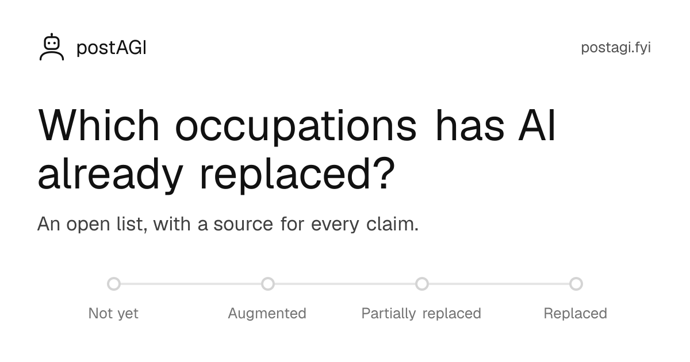
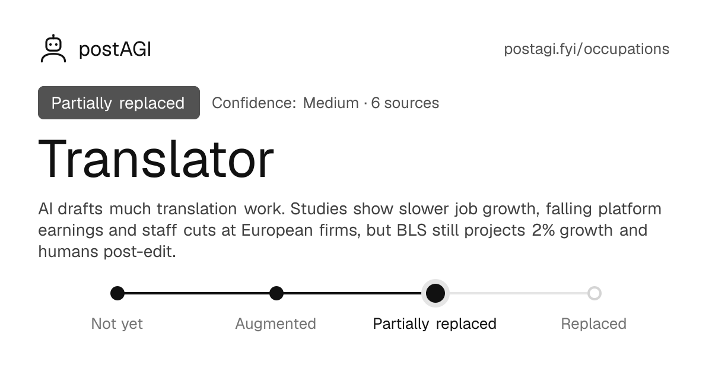

<p align="center">
  
</p>

<h1 align="center">postAGI</h1>

<p align="center">
  <strong>Which occupations has AI already replaced?</strong><br>
  An open list with a status, the evidence and a source for every claim.
</p>

<p align="center">
  <a href="https://github.com/wonsukchoi/postAGI/actions/workflows/ci.yml"></a>
  <a href="LICENSE"></a>
  <a href="https://postagi.fyi"></a>
</p>

<p align="center">
  <a href="https://postagi.fyi">Website</a> ·
  <a href="https://postagi.fyi/occupations">Occupations</a> ·
  <a href="https://postagi.fyi/methodology">Methodology</a> ·
  <a href="CONTRIBUTING.md">Contribute</a>
</p>

<p align="center">
  
  
</p>

## What this is

Most writing about AI and jobs is prediction. postAGI tracks what has **already happened**. Each occupation gets a status, a confidence level, a plain-prose write-up and the sources behind it. It is not a forecast, and it says so when the evidence is thin.

The data lives in this repository, so anyone can correct it with a pull request.

## How a job is rated

Every occupation sits at one of four points on a line:

```text
Not yet ──── Augmented ──── Partially replaced ──── Replaced
```

| Status | Meaning |
|---|---|
| `not-yet` | AI does none of the core work in everyday practice, or does it only in small pilots. |
| `augmented` | AI is in common use but mainly makes workers faster. Headcount has not fallen because of it. |
| `partial` | AI does a large share of the tasks and demand for human workers has measurably fallen, but humans still do part of the job. |
| `replaced` | AI does the core work end to end, and employers have stopped hiring humans for it at meaningful scale. |

A separate **confidence** level (`low`, `medium`, `high`) says how well the sources support the status. The full definitions are on the [methodology page](https://postagi.fyi/methodology).

## Run it locally

You need Node.js 20.9 or newer. CI runs on Node 22.

```bash
npm install
npm run dev        # http://localhost:3000
```

| Command | What it does |
|---|---|
| `npm run validate` | Checks every file in `content/occupations/` against the schema |
| `npm run lint` | Runs ESLint |
| `npm run typecheck` | Generates route types, then runs the TypeScript compiler |
| `npm run build` | Validates the data, then builds the static site into `out/` |

## Add or fix an occupation

1. Copy a file in `content/occupations/` and name it `<slug>.json`. The slug is lowercase with hyphens and must match the `slug` field.
2. Fill in every field and cite at least one source.
3. Run `npm run validate`. A bad file fails with a message that names the field.
4. Open a pull request. The template has a checklist.

A file looks like this:

```json
{
  "slug": "translator",
  "title": "Translator",
  "sector": "Language",
  "status": "partial",
  "summary": "One plain sentence, 200 characters at most.",
  "metaDescription": "Optional. 50 to 160 characters, a short version of the summary for search results.",
  "tasksAutomatedPct": null,
  "yearReplaced": null,
  "confidence": "medium",
  "updatedAt": "2026-11-06",
  "draft": false,
  "aiTools": [
    {
      "name": "Tool name",
      "description": "What it does, in one line.",
      "url": "https://example.com/page-showing-the-tool-doing-the-job",
      "logo": "/tools/tool-name.svg"
    }
  ],
  "tasks": [
    { "task": "A specific task", "status": "partial", "sourceUrl": "https://example.com/source" }
  ],
  "evidence": "Plain prose. Paraphrase and attribute: who found what, and when.\n\nSeparate paragraphs with a blank line. State the limits.",
  "sources": [{ "title": "Descriptive title", "url": "https://example.com/source" }]
}
```

The rules that keep the data honest:

- **Every claim needs a source** you have actually read. Prefer primary sources: studies, official statistics, filings.
- **Leave `tasksAutomatedPct` and `yearReplaced` as `null`** unless a source states the number.
- **`replaced` needs the strongest evidence.** Company announcements alone are not enough, so check whether they were later walked back.
- **`draft: true`** marks placeholder or unverified pages. They show a banner and are left out of the page's structured data.

Details, including the optional tool `logo` field, are in [CONTRIBUTING.md](CONTRIBUTING.md).

## Project layout

```text
content/occupations/     One JSON file per occupation. This is the data.
public/tools/            AI tool logos
src/app/                 Pages, sitemap, robots.txt and the generated preview images
src/components/          UI components
src/lib/schema.ts        The data schema and the status and confidence definitions
src/lib/occupations.ts   Loads and validates the data at build time
scripts/validate.ts      Checks every data file
```

## How it is built and deployed

The site is built with [Next.js](https://nextjs.org), TypeScript, Tailwind CSS and [Zod](https://zod.dev). It is fully static: `npm run build` validates the data and writes plain files to `out/`. A broken data file fails the build, so it cannot ship.

The live site runs on [Cloudflare Workers](https://developers.cloudflare.com/workers/static-assets/) as static assets. The setup is in `wrangler.jsonc`.

To deploy, run `npm run deploy` from a clean `main`. It builds the site, deploys it, purges Cloudflare's cache so no edge location keeps serving the old version, and then checks that every page and file on the live site loads. It needs `npx wrangler login` and three environment variables:

| Variable | What it is |
|---|---|
| `CLOUDFLARE_ACCOUNT_ID` | Only needed if your login can see more than one Cloudflare account |
| `CLOUDFLARE_API_TOKEN` | A token with the **Zone, Cache Purge, Purge** permission |
| `CLOUDFLARE_ZONE_ID` | The zone ID of your domain, shown on its Cloudflare Overview page |

`npm run purge-cache` and `npm run verify:live` run the last two steps on their own.

To host your own copy, change the `routes` entry in `wrangler.jsonc` to your domain, or remove it to use a `workers.dev` address.

## License

[MIT](LICENSE). Tool logos are trademarks of their owners and appear only to identify the tool.
